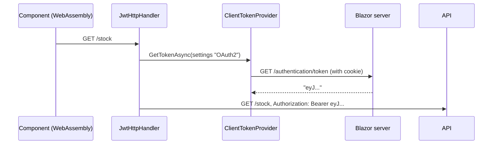

# Blazor

A Blazor application needs two things from Arc4u: the `AppPrincipal` of the signed-in user in its
components (through the [application context](../../concepts/glossary.md#application-context)),
and a token to call APIs. How they are obtained depends on where the component runs. The user
signs in on the server with OpenID Connect and a cookie, as described in
[Server authentication](../authentication-server/index.md).

Only Blazor Web Apps, whose server signs the user in, are supported. A standalone Blazor
WebAssembly app, which signs the user in from the browser (`AddMsalAuthentication` or
`AddOidcAuthentication`), is not.

| Render mode | Where the code runs | Arc4u provides |
|---|---|---|
| Interactive WebAssembly | In the browser | The principal rebuilt from the authentication state sent by the server; a token fetched from the server with the cookie (`ClientTokenProvider`). |
| Interactive Server | On the server, in a SignalR circuit | The principal set in the `IApplicationContext` of the circuit. |
| Interactive Auto | Both, one after the other | Both of the above. See [Hybrid rendering](#hybrid-rendering). |

## Packages involved

| Package | Use it for |
|---|---|
| `Arc4u.OAuth2.Blazor` | The WebAssembly project: token providers, the `JwtHttpHandler` for `HttpClient`, `AddAuthenticationCookie`, and the principal built from the authentication state. |
| `Arc4u.OAuth2.AspNetCore.Blazor` | The server project: the principal of Interactive Server components (`AppPrincipalServerAuthenticationStateProvider`, `ApplicationContextCircuitHandler`), the end of a circuit whose sign-in has ended (`AddAppPrincipalCircuitRevalidation`), and the claims sent to WebAssembly (`AuthenticationStateClaimsSerializer`). |

```bash
dotnet add package Arc4u.OAuth2.Blazor
dotnet add package Arc4u.OAuth2.AspNetCore.Blazor
```

## WebAssembly: call APIs with the user's token

The WebAssembly app cannot read the authentication cookie of the server, and should not store
tokens in the browser. Instead, <xref:Arc4u.OAuth2.TokenProvider.ClientTokenProvider> asks the
server for the access token of the signed-in user: the browser sends the cookie with the request,
and the server answers with the token.



### Configure the WebAssembly app

`AddAuthenticationCookie(builder.Configuration)` reads `Authentication:OAuth2.Settings` (pass
`sectionName` to use another section) and registers the settings named `OAuth2` (pass
`sectionKey` to change it). It also registers a named `HttpClient` whose requests include the
browser cookies. The section must exist; an overload takes an
`Action<AuthenticationCookieSettingsOption>` instead.

```json
{
  "Authentication": {
    "OAuth2.Settings": {
      "BaseUri": "https://app.example.com",
      "TokenRequestUrl": "/authentication/token"
    }
  }
}
```

| Key | Type | Default | Description |
|---|---|---|---|
| `Authentication:OAuth2.Settings:BaseUri` | `Uri` | `https://localhost` | Base address of the Blazor server. |
| `Authentication:OAuth2.Settings:TokenRequestUrl` | `string` | `/authentication/token` | Server endpoint that returns the token. |
| `Authentication:OAuth2.Settings:HttpClientName` | `string` | `Authentication` | Name of the `HttpClient` that calls the server. |
| `Authentication:OAuth2.Settings:ProviderId` | `string` | `Client` | Key of the token provider. |

```csharp
// Program.cs (WebAssembly project)
using Arc4u.Blazor.Handlers;
using Arc4u.Blazor.Options;
using Arc4u.Configuration;
using Arc4u.Dependency;
using Arc4u.OAuth2.Token;
using Arc4u.OAuth2.TokenProvider;
using Microsoft.AspNetCore.Components.WebAssembly.Hosting;

var builder = WebAssemblyHostBuilder.CreateDefault(args);

builder.Services.AddILogger();
builder.Services.AddTransient<AttachCookiesHandler>();
builder.Services.AddAuthenticationCookie(builder.Configuration);
builder.Services.AddKeyedSingleton<ITokenProvider, ClientTokenProvider>(ClientTokenProvider.ProviderName);

builder.Services.AddHttpClient<InventoryClient>(client => client.BaseAddress = new Uri("https://inventory.example.com/"))
    .AddHttpMessageHandler(sp => new JwtHttpHandler(
        sp,
        sp.GetRequiredService<ILogger<JwtHttpHandler>>(),
        "OAuth2"));

await builder.Build().RunAsync();
```

`AttachCookiesHandler` must be registered because `AddAuthenticationCookie` adds it to its
`HttpClient`. <xref:Arc4u.Blazor.Handlers.JwtHttpHandler> resolves the settings named `OAuth2`
(it throws `ConfigurationException` when none exist), and sends the token in the `Authorization`
header, with the token type as the scheme; when the provider fails, it logs the error and sends
the request without a token. `ClientTokenProvider` keeps the token until it expires, so the token
must be a JWT (it reads its expiration).

### Expose the token on the server

Arc4u does not map the token endpoint: add it to the server project. It must require an
authenticated user and return the access token as a JSON string. With the OpenID Connect and
cookie authentication of [Server authentication](../authentication-server/index.md), the `Oidc`
token provider gives the user's access token, refreshed when needed:

```csharp
// Program.cs (server project)
using Arc4u.Configuration;
using Arc4u.OAuth2;
using Arc4u.OAuth2.Token;
using Arc4u.OAuth2.TokenProviders;
using Microsoft.Extensions.Options;

var builder = WebApplication.CreateBuilder(args);

// ... OpenID Connect and cookie authentication: see the Server authentication guide.
builder.Services.AddKeyedScoped<ITokenProvider, OidcTokenProvider>(OidcTokenProvider.ProviderName);

var app = builder.Build();

app.MapGet("/authentication/token", async (HttpContext context, IOptionsMonitor<SimpleKeyValueSettings> settings) =>
{
    var provider = context.RequestServices.GetRequiredKeyedService<ITokenProvider>(OidcTokenProvider.ProviderName);
    var token = await provider.GetTokenAsync(settings.Get(Constants.CookiesAuthenticationType), null);

    return token.IsSuccess ? Results.Ok(token.Value.Token) : Results.Unauthorized();
}).RequireAuthorization();

app.Run();
```

> [!CAUTION]
> This endpoint hands out the user's access token to any caller that holds the cookie. Keep the
> authentication cookie `HttpOnly` and `SameSite`, and do not let other origins call the endpoint
> with credentials (CORS).

### Get the principal in WebAssembly components

From .NET 9, the server can serialize the authentication state into the page and the
WebAssembly app can read it back. Arc4u plugs into the deserialization:
<xref:Arc4u.Blazor.Options.ConfigureAuthStateDeserializationOptions> sets the callback, and
<xref:Arc4u.Blazor.AppPrincipalFromAuthenticationState> builds an `AppPrincipal` from the claims
with the `IClaimAuthorizationFiller` and `IClaimProfileFiller`, and sets it in the
`IApplicationContext`. An anonymous user gets a principal without operations.

```csharp
// Program.cs (WebAssembly project)
using Arc4u.Blazor;
using Arc4u.Blazor.Options;
using Arc4u.Security.Principal;
using Microsoft.AspNetCore.Components.WebAssembly.Authentication;
using Microsoft.AspNetCore.Components.WebAssembly.Hosting;

var builder = WebAssemblyHostBuilder.CreateDefault(args);

builder.Services.AddAuthorizationCore();
builder.Services.AddCascadingAuthenticationState();
builder.Services.AddAuthenticationStateDeserialization();

builder.Services.AddSingleton<IApplicationContext, ApplicationInstanceContext>();
builder.Services.AddSingleton<IClaimAuthorizationFiller, ClaimsAuthorizationFiller>();
builder.Services.AddSingleton<IClaimProfileFiller, ClaimsProfileFiller>();
builder.Services.AddSingleton<IAppPrincipalAuthenticationStateProvider, AppPrincipalFromAuthenticationState>();
builder.Services.AddSingleton<IConfigureOptions<AuthenticationStateDeserializationOptions>, ConfigureAuthStateDeserializationOptions>();

await builder.Build().RunAsync();
```

By default, Blazor only sends the name and role claims. Send the other claims the WebAssembly
components read with <xref:Arc4u.Blazor.AuthenticationStateClaimsSerializer>, which takes the list
of claim types to send:

```csharp
// Program.cs (server project)
using System.Security.Claims;
using Arc4u.Blazor;

builder.Services.AddRazorComponents()
    .AddInteractiveWebAssemblyComponents()
    .AddAuthenticationStateSerialization(options =>
        options.SerializationCallback = AuthenticationStateClaimsSerializer.Create(ClaimTypes.Email, "company"));
```

> [!WARNING]
> Do not set `SerializeAllClaims = true`. The authentication state is written into the HTML of
> every page, so it would send every claim of the user to the browser: the identifiers of the
> identity provider, the authorization claim, and the key of the user's session in the cookie's
> session store (`arc4u_session_key`). The serializer never sends that key, even when it is listed.

The authorization of the `AppPrincipal` built in the browser comes from the claims sent. List
`Arc4u.IdentityModel.Claims.ClaimTypes.Authorization` only if the WebAssembly components check
operations themselves; the server, where the APIs check them, does not need it.

## Interactive Server: get the principal in the circuit

An Interactive Server component runs in a SignalR circuit, which has its own dependency injection
scope. The `IApplicationContext` filled during the HTTP request is not the one of the circuit, so
without Arc4u the component event handlers see no principal. `Arc4u.OAuth2.AspNetCore.Blazor`
fills the circuit's `IApplicationContext` in two places:

- <xref:Arc4u.Blazor.AppPrincipalServerAuthenticationStateProvider> replaces the Blazor
  `ServerAuthenticationStateProvider`: each time the authentication state is read, it builds the
  `AppPrincipal` and sets it in the `IApplicationContext`.
- <xref:Arc4u.Blazor.ApplicationContextCircuitHandler> does the same when the circuit connects, so
  the principal is there even before a component reads the authentication state.

Both also follow the changes of the circuit's authentication state. When the circuit reconnects,
Blazor gives it the user of the new connection: another user, or no user after a sign-out in another
tab. A revalidating provider can also turn the state anonymous. The principal is then rebuilt for the
new user, or cleared, so the event handlers never keep acting as the previous user. The handler does
this with any `AuthenticationStateProvider`, including one of your own that replaces
`AppPrincipalServerAuthenticationStateProvider`.

```csharp
// Program.cs (server project)
using Arc4u.Blazor;
using Arc4u.Security.Principal;
using Microsoft.AspNetCore.Components.Authorization;
using Microsoft.AspNetCore.Components.Server.Circuits;

var builder = WebApplication.CreateBuilder(args);

// ... OpenID Connect and cookie authentication: see the Server authentication guide.

builder.Services.AddRazorComponents().AddInteractiveServerComponents();
builder.Services.AddCascadingAuthenticationState();

builder.Services.AddScoped<IApplicationContext, ApplicationInstanceContext>();
builder.Services.AddScoped<AuthenticationStateProvider, AppPrincipalServerAuthenticationStateProvider>();
builder.Services.AddScoped<CircuitHandler, ApplicationContextCircuitHandler>();

var app = builder.Build();
app.Run();
```

`IApplicationContext` must be scoped, so that each circuit and each request has its own. The
claims fillers (`IClaimAuthorizationFiller`, `IClaimProfileFiller`) are the ones of the server
authentication. Only the principal is set in the circuit: the tokens kept for the HTTP request
(`TokenRefreshInfo`) are not.

When the circuit's state turns anonymous, the provider and the handler remove the user from the
circuit and also from the request scope of the circuit's SignalR connection. In a circuit,
`IScopedServiceProviderAccessor` resolves that request scope, so the `JwtHttpHandler` and the gRPC
interceptor read its principal and its `TokenRefreshInfo`. Clearing only the circuit's principal
would let them keep calling APIs with the user's access token, and refresh it.

### End the circuit when the sign-in ends

A circuit keeps the user it connected with until it reconnects. Without a check, a tab left open
would keep acting as the user after they sign out in another tab, or after their session expires.
`AddAppPrincipalCircuitRevalidation` turns the check on: `AppPrincipalServerAuthenticationStateProvider`
then checks every `Interval` (two minutes by default) that the sign-in of an authenticated circuit
still exists. When the sign-in has ended, or the check throws, the circuit becomes anonymous and the
user is removed as described above. `AuthorizeView` and the interactive `[Authorize]` pages then
render their anonymous content. An anonymous visitor is never checked, and pages rendered without
interactivity (static SSR) have no circuit: each request reads the cookie.

Register the provider with it instead of the two `AddScoped` lines above:

```csharp
// Program.cs (server project)
using Arc4u.Blazor;

builder.Services.AddOidcAuthentication(builder.Configuration);
builder.Services.AddAppPrincipalCircuitRevalidation(builder.Configuration);
```

```json
{
  "Authentication": {
    "CircuitRevalidation": {
      "Interval": "00:02:00"
    }
  }
}
```

| Key | Type | Default | Description |
|---|---|---|---|
| `Authentication:CircuitRevalidation:Enabled` | `bool` | `true` | Whether the sign-in of an open circuit is checked. Turned off, a circuit keeps its user until it reconnects. |
| `Authentication:CircuitRevalidation:Interval` | `TimeSpan` | `00:02:00` | How long a circuit may act as a user whose sign-in has ended. More than zero, at most one day. |
| `Authentication:CircuitRevalidation:CookieScheme` | `string` | `Cookies` | The cookie scheme whose session store holds the sign-ins. |

> [!IMPORTANT]
> The call is required. It wraps the cookie's session store in
> <xref:Arc4u.Blazor.SessionKeyTicketStore>, which stamps each principal read from it with the key
> of its ticket (`arc4u_session_key`). Without it the principals carry no key, nothing can be
> checked, and the circuits keep their user until they reconnect; the validator then logs warning
> 9303 once. Only applications that call it get the claim: an MVC or Razor Pages application has
> no use for it.

The call can come before or after `AddOidcAuthentication`: the session store is wrapped once all
the cookie options are configured. Call it after any other registration of
`AuthenticationStateProvider`, including Arc4u's generated `RegisterTypes`, as it removes them. It
also adds `ApplicationContextCircuitHandler`, and validates the options at startup. When the cookie
has no session store, the whole ticket is in the cookie and the server has nothing to check: Arc4u
logs warning 9302 and the circuits keep their user.

The default check, <xref:Arc4u.Blazor.SessionStoreSignInValidator>, asks the cookie's session
store whether it still holds the ticket of the sign-in. Sign-out removes the ticket, and so does
its expiry, so the circuits of that browser session end; the user's other sessions do not. The
sign-in is ended when the ticket is gone, has expired, or belongs to another user. To check
elsewhere (for example at the identity provider), register your own
<xref:Arc4u.Blazor.ISignInValidator>; the provider uses it instead.

Each check is one read of the session store per open circuit. The first check after a sign-out
finds no ticket, which `CacheTicketStore` and `FileTicketStore` log at the `Debug` level.

## Hybrid rendering

With the Interactive Auto render mode, a component first runs on the server and then in the
browser, so the application needs both setups above: on the server, the circuit's
`IApplicationContext` is filled as described in
[Interactive Server](#interactive-server-get-the-principal-in-the-circuit); in the browser, the
principal is rebuilt from the serialized authentication state. Only the claims that the server
serializes reach the browser, so the authorization built there is only as complete as those claims.

The revalidation of [End the circuit when the sign-in ends](#end-the-circuit-when-the-sign-in-ends)
only covers the server part. In the browser, the WebAssembly app keeps the state written into the
page; its calls to APIs fail once the sign-in has ended, because the token endpoint answers them
with the cookie, which no longer works.

## Troubleshooting

### No service for type AttachCookiesHandler has been registered

`ClientTokenProvider` logs this `InvalidOperationException` and the API is called without a token:
`AddAuthenticationCookie` adds `AttachCookiesHandler` to its `HttpClient`, but does not register it. Add
`builder.Services.AddTransient<AttachCookiesHandler>();`.

### The API is called without a token

When `ClientTokenProvider` fails, the `JwtHttpHandler` of the WebAssembly app sends the request
anyway. Check that the settings name given to the handler is the one registered by
`AddAuthenticationCookie` (`OAuth2` by default), that the token endpoint answers with a 200 status
in the browser developer tools, and that it returns a JSON string (`"eyJ..."`), not plain text.

### The principal is null in an event handler of an Interactive Server component

Register `AppPrincipalServerAuthenticationStateProvider` and `ApplicationContextCircuitHandler`, and
register `IApplicationContext` as scoped (a singleton is shared by all users).

## See also

- [Server authentication](../authentication-server/index.md)
- [HttpClient and gRPC clients](httpclient-grpc.md)
- [ASP.NET Core Blazor authentication and authorization](https://learn.microsoft.com/aspnet/core/blazor/security/)
- <xref:Arc4u.Blazor> in the API reference
