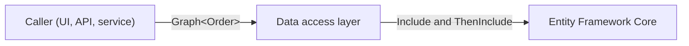

# Include graphs

<xref:Arc4u.Graph`1> holds the include paths of an aggregate: the references and collections a caller wants loaded with it, such as an order with its customer and the products of its lines. It lives in the base `Arc4u` package, so the layers that decide what to load do not reference Entity Framework Core. The data access layer applies the paths with [Entity Framework Core](efcore.md). The [design principles](../../concepts/design-principles.md) explain why Arc4u builds on EF Core instead of wrapping it.

## What it solves

The caller of a service knows which parts of an aggregate it needs; the data access layer knows how to load them. `Graph<T>` carries that choice between the two as a list of paths (`Customer.Address`, `Lines.Product`):

- The paths are built from expressions, so a renamed property is a compile error, not a failed query.
- A graph serializes with `System.Text.Json`, so a client can send it to a service.
- A graph loads nothing itself. `Arc4u.EfCore` turns its paths into `Include` and `ThenInclude` calls.



## Install

```bash
dotnet add package Arc4u --prerelease
```

`Graph<T>` is in the `Arc4u` namespace of the base `Arc4u` package. To apply a graph to a query, the data access layer also needs `Arc4u.EfCore` (see [Entity Framework Core](efcore.md#install)).

## Build a graph

The samples on this page use this model:

```csharp
public class Order
{
    public Guid Id { get; set; }
    public Customer Customer { get; set; } = null!;
    public List<OrderLine> Lines { get; set; } = [];
}

public class Customer
{
    public Guid Id { get; set; }
    public string Name { get; set; } = string.Empty;
    public Address Address { get; set; } = null!;
}

public class Address
{
    public Guid Id { get; set; }
    public string City { get; set; } = string.Empty;
}

public class OrderLine
{
    public Guid Id { get; set; }
    public Product Product { get; set; } = null!;
}

public class Product
{
    public Guid Id { get; set; }
    public string Label { get; set; } = string.Empty;
}
```

Call `Include` once per path. It returns the graph, so the calls chain:

```csharp
using Arc4u;

var graph = new Graph<Order>()
    .Include(o => o.Customer.Address)
    .Include(o => o.Lines.Select(l => l.Product));

// graph.Includes: "Customer.Address", "Lines.Product"
```

- Follow a reference with `.` and go through a collection with `Select` (or `SelectMany`). For a collection inside a collection, nest the `Select` calls.
- Other operators, such as `Where`, `OrderBy`, `Take` or `First`, keep the path of the collection they apply to: `o => o.Lines.Where(l => l.Product != null)` is the path `Lines`.
- A path also includes the properties along it: `Customer.Address` loads the customer too.
- A path added twice is kept once.
- Only navigation properties belong in a path: references to a class, and arrays or generic collections of one class. `Include` throws a `MemberAccessException` for anything else, such as a `string`, a value type, or a collection of those.

### Build a graph from paths

When the paths come as text (from configuration, for example), pass them to the constructor:

```csharp
var graph = new Graph<Order>(["Customer.Address", "Lines.Product"]);
```

The constructor checks every property of every path against the model and throws a `MissingMemberException` for the first one that cannot be included. Property names are case-sensitive. Setting the `Includes` property checks the paths the same way.

## Common scenarios

### Check what the caller asked for

```csharp
if (graph.Exist(o => o.Lines))
{
    // ... compute what depends on the lines
}
```

`Exist` returns `true` when the graph contains the path or a path below it. With `Lines.Product`, both `o => o.Lines` and `o => o.Lines.Select(l => l.Product)` exist. Paths are compared by whole property names and with their casing: `Line` does not match `Lines.Product`.

### Pass part of a graph to another component

`GetGraph` returns the paths below a first-level property, as a graph of that property's type:

```csharp
Graph<Customer> customerGraph = graph.GetGraph(o => o.Customer);
// customerGraph.Includes: "Address"
```

It takes one level at a time: `o => o.Customer.Address` throws an `InvalidOperationException`. Call `GetGraph` again on the result to go deeper.

For a collection property, the result is a graph of the collection. Its paths start at the item type, and you go through the items with `Select`:

```csharp
Graph<List<OrderLine>> linesGraph = graph.GetGraph(o => o.Lines);
// linesGraph.Includes: "Product"

bool withProducts = linesGraph.Exist(lines => lines.Select(l => l.Product));
```

### Remove what a caller must not load

`RemoveGraph` returns a copy of the graph without a property and the paths below it. The original graph does not change.

```csharp
// Customers are served by another endpoint.
var allowed = graph.RemoveGraph(o => o.Customer);
// allowed.Includes: "Lines.Product"
```

A graph only stores full paths, so removing `o => o.Customer.Address` from a graph that holds `Customer.Address` also stops loading the customer. Include `o => o.Customer` as well to keep it.

> [!CAUTION]
> A graph received from a caller decides what the service loads, and often what it returns. Remove the branches the caller must not see before you apply the graph.

### Build a graph from a loaded object

`Parse` returns the graph of what an instance holds, for example to load the same parts again:

```csharp
var order = new Order
{
    Customer = new Customer(),
    Lines = [new OrderLine { Product = new Product() }],
};

var loaded = Graph<Order>.Parse(order);
// loaded.Includes: "Customer", "Lines.Product"
```

- A `null` reference or collection is not in the graph.
- For a collection, `Parse` reads the first item. An empty collection is in the graph; pass `shouldHaveElement: true` to leave it out.
- `Parse` follows the public properties of the declared type of each property: a property that only a subclass declares is ignored, and so are non-public and static properties and indexers.
- It does not follow a reference back to an object it is already reading, so cyclic object graphs work.

### Send a graph to another process

`Graph<T>` serializes with `System.Text.Json` as its list of paths, with the reflection-based serializer and with a source-generated `JsonSerializerContext` alike:

```csharp
using System.Text.Json;

var json = JsonSerializer.Serialize(graph);
// {"Includes":["Customer.Address","Lines.Product"]}

var received = JsonSerializer.Deserialize<Graph<Order>>(json)!;
var checkedGraph = new Graph<Order>(received.Includes);
```

Deserializing does not check the paths, because the check needs reflection on `T`. Check a graph received from another process with `new Graph<Order>(received.Includes)` before you use it: the constructor throws a `MissingMemberException` for a path that does not match the model.

## Pitfalls

- **Reflection and trimming.** The constructor that takes paths, the `Includes` setter and `Parse` look up properties by name with reflection. They are marked `[RequiresUnreferencedCode]`, because trimming can remove those properties. `new Graph<T>()`, `Include`, `Exist`, `GetGraph` and `RemoveGraph` work on expressions and strings only: use them in a trimmed or Native AOT application (see [Native AOT and trimming](../native-aot.md)).
- **`Includes` returns a copy.** Adding to the returned list does not change the graph: use `Include`, or set `Includes`.
- **`Parse` calls the property getters.** With lazy-loading proxies, it loads every navigation it reads.

## Troubleshooting

### `MissingMemberException` when you create a graph from paths

The message names the first property of a path that cannot be included:

- It does not exist on the type reached so far, or its casing differs (`customer` instead of `Customer`).
- It is not a navigation property: a `string`, a value type, an interface, a collection of strings, value types or collections, or a collection that is not generic.

Fix the path, or build it with `Include` so that the compiler checks it.

### `MemberAccessException: Including a type of string is not allowed when you try to define a graph path.`

The expression passed to `Include` ends on a `string` or a collection of strings, for example `o => o.Customer.Name`. Include the entity that holds it instead: `o => o.Customer`.

### `InvalidOperationException: It is not allowed to check more than one level!`

`GetGraph` received a path deeper than one property. Go one level at a time: `graph.GetGraph(o => o.Customer).GetGraph(c => c.Address)`.

## See also

- [Entity Framework Core](efcore.md) to apply a graph to a query
- [Data access](index.md)
- <xref:Arc4u.Graph`1> in the API reference
