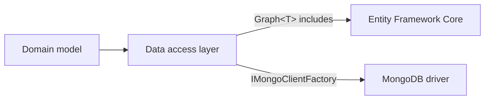

# Data access

Arc4u does not replace Entity Framework Core, the MongoDB driver or ASP.NET Core OData. It adds a small layer on top of them for the [data access layer](../../concepts/glossary.md#data-access-layer) of a service: include paths (`Graph<T>`) applied to Entity Framework Core queries, a `DbContext`-like abstraction for MongoDB, and the two settings OData needs behind a reverse proxy. The pieces build on the layering described in the [architecture concept](../../concepts/architecture.md).

## What it solves

A service persists the aggregates of its domain model. The domain model decides what changes (its methods add, edit or remove children); the data access layer only loads and saves aggregates with the underlying library. Arc4u does not track changes on entities: use the change tracking of Entity Framework Core, or the update API of the MongoDB driver.



Arc4u deliberately leaves the following to the underlying libraries: choosing an EF Core provider, mapping, migrations, querying, and everything about the MongoDB driver except the client and collection lookup. `Arc4u.OData` is not an OData implementation: it only fixes the URLs in OData responses when a service sits behind a proxy.

## Packages involved

| Package | Use it for |
|---|---|
| `Arc4u.EfCore` | Applying `Graph<T>` includes to queries. See [Entity Framework Core](efcore.md). |
| `Arc4u.MongoDB` | Registering a MongoDB database context and getting collections mapped to entity types. See [MongoDB](mongodb.md). |
| `Arc4u.OData` | Rewriting the URLs in OData responses behind a reverse proxy. See [OData](odata.md). |

The packages do not reference each other. `Graph<T>` lives in the base `Arc4u` package, which `Arc4u.EfCore` references, so a caller can build a graph without referencing EF Core.

## Install

Install only what the service uses:

```bash
dotnet add package Arc4u.EfCore --prerelease
dotnet add package Arc4u.MongoDB --prerelease
dotnet add package Arc4u.OData --prerelease
```

You also need an EF Core provider package (for example `Microsoft.EntityFrameworkCore.SqlServer`) or a reachable MongoDB server; Arc4u ships neither.

## Configuration

`Arc4u.EfCore` and `Arc4u.OData` read no configuration section. `Arc4u.MongoDB` reads one connection string from the standard `ConnectionStrings` section, whose name you pass to `AddMongoDatabase`. The keys are described in [MongoDB](mongodb.md#configuration).

## Common scenarios

### Load an aggregate with its children from EF Core

```csharp
using Arc4u;
using Arc4u.EfCore;
using Microsoft.EntityFrameworkCore;

public class OrderRepository(ShopContext db)
{
    public Task<List<Order>> GetAllAsync(Graph<Order> graph, CancellationToken cancellationToken) =>
        graph.ApplySetReferences(db.Orders).ToListAsync(cancellationToken);
}
```

`ShopContext` and `Order` are defined in [Entity Framework Core](efcore.md#apply-the-includes-of-a-graph-to-a-query).

### Read a MongoDB collection mapped to an entity

```csharp
using Arc4u.MongoDB;
using MongoDB.Driver;

public class ProductStore(IMongoClientFactory<ShopContext> factory)
{
    public Task<List<Product>> GetAllAsync(CancellationToken cancellationToken) =>
        factory.GetCollection<Product>().Find(FilterDefinition<Product>.Empty).ToListAsync(cancellationToken);
}
```

`ShopContext` and `Product` are defined in [MongoDB](mongodb.md#step-by-step-setup).

### Expose OData behind a gateway

See [OData](odata.md#configure-the-base-address).

## Extensibility points

| Service | Default implementation | Replace it to |
|---|---|---|
| `IMongoClientFactory<TContext>` | <xref:Arc4u.MongoDB.DefaultMongoClientFactory`1> | Control how the client and database are created. `AddMongoDatabase` registers the default with `TryAdd`, so register your own before calling it. |

`Arc4u.EfCore` is a static helper, without dependency injection registrations.

## Troubleshooting

### `MongoClientException: No mongo client settings defined for key ...`

`DefaultMongoClientFactory<TContext>.CreateClient` found no `MongoClientSettings` registered for the lower-case database name of the context. `AddMongoDatabase` registers them under that name, so this only happens when you register the context or the settings yourself. See [MongoDB troubleshooting](mongodb.md#troubleshooting).

### More symptoms

Symptoms specific to one package are on its page: [Entity Framework Core](efcore.md#troubleshooting), [MongoDB](mongodb.md#troubleshooting), [OData](odata.md#troubleshooting).

## See also

- [Entity Framework Core](efcore.md), [MongoDB](mongodb.md), [OData](odata.md)
- [Glossary: data access layer](../../concepts/glossary.md#data-access-layer)
- <xref:Arc4u.EfCore> in the API reference
