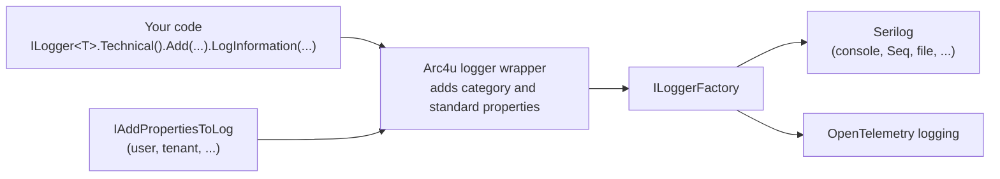
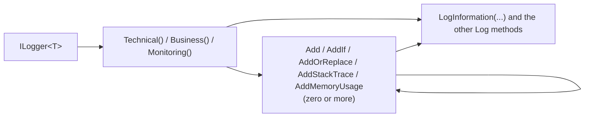

# Diagnostics and logging

Arc4u extends `Microsoft.Extensions.Logging` with a fluent API. It puts every log entry in one of three categories (Technical, Business or Monitoring), adds a standard set of properties (application, class, method, process, thread, user) and lets you attach your own properties without putting them in the message template. It is the logging layer that the other Arc4u packages use, and it follows the [design principles](../../concepts/design-principles.md): Arc4u adds a thin layer on top of what .NET already provides and does not replace it.

## What it solves

With plain `ILogger<T>` you get a message and the values of its template. In a business application you also need to:

- tell apart what IT people read (Technical), what business people read (Business) and the periodic measures for dashboards (Monitoring), so each audience gets its own sink or filter;
- find, on every entry, which application, class, method, process, thread and user produced it, without repeating that in each message;
- add a value to one entry (an order number, a duration) without polluting the message text.

Arc4u replaces the `ILogger<T>` registration with a wrapper that adds these properties and forwards the entry to the logger created by the `ILoggerFactory`. Everything after that is standard .NET: the providers you configure (Serilog, OpenTelemetry, console) receive the entry and decide what to do with it. Arc4u does not ship a sink you must use, and Arc4u.Diagnostics does not reference Serilog.



> [!NOTE]
> Arc4u 8 also had `TraceListener` based logging. It was removed in Arc4u 9 because Serilog and OpenTelemetry cover it. See [TraceListeners removed](../../migration/8x-to-9.md#tracelisteners-removed) in the migration guide.

## Packages involved

| Package | Use it for |
|---|---|
| `Arc4u.Diagnostics` | The fluent API (`Technical()`, `Business()`, `Monitoring()`, `Add`, `AddIf`, ...), `AddILogger`, the process monitoring (`AddSystemMonitoring`) and the `IActivitySourceFactory` used for OpenTelemetry traces. |
| `Arc4u.Diagnostics.Serilog` | A one-line text formatter, the category filter and anonymizer sinks, and the helper that reads the Arc4u properties from a Serilog event. See [Serilog](serilog.md). |
| `Arc4u.Diagnostics.Serilog.Sinks.RealmDb` | Sinks that keep the log entries in a Realm database or in memory, so a client application can show its own logs. See [Client-side log storage](frontend-logging.md). |

`Arc4u.Diagnostics.Serilog` and `Arc4u.Diagnostics.Serilog.Sinks.RealmDb` reference `Arc4u.Diagnostics`. The `Arc4u` package also references `Arc4u.Diagnostics`, and its `AddApplicationContext()` calls `AddILogger()` for you.

## Install

```bash
dotnet add package Arc4u.Diagnostics --prerelease
```

To write to Serilog sinks, add the Serilog integration and the hosting package that connects Serilog to `Microsoft.Extensions.Logging`:

```bash
dotnet add package Arc4u.Diagnostics.Serilog --prerelease
dotnet add package Serilog.AspNetCore
```

## Configuration

`AddILogger()` has no configuration section of its own. The only setting it reads is the application name written in the `Application` property of each entry.

| Key | Type | Default | Description |
|---|---|---|---|
| `Application.Configuration:Environment:LoggingName` | `string` | name of the entry assembly | Value of the `Application` property. Bound to `Arc4u.Configuration.ApplicationConfig` by `AddApplicationConfig`, which is described in the [configuration guide](../configuration/index.md). |

> [!NOTE]
> The `LoggingLevel` key that older Arc4u documentation showed in this section is not read by the code. Filter by level in your logging provider (for example the Serilog `MinimumLevel`).

### Code

```csharp
// Program.cs
using Arc4u.Dependency;
using Arc4u.Diagnostics;
using Arc4u.Diagnostics.Formatter;
using Serilog;
using Serilog.Events;

var builder = WebApplication.CreateBuilder(args);

builder.Services.AddILogger();

builder.Host.UseSerilog((context, configuration) => configuration
    .MinimumLevel.Information()
    .MinimumLevel.Override("Microsoft", LogEventLevel.Warning)
    .WriteTo.Console(new SimpleTextFormatter()));

var app = builder.Build();

app.MapGet("/orders/{id:int}", (int id, ILogger<Program> logger) =>
{
    logger.Technical().LogInformation("Reading order {OrderId}", id);
    logger.Business().Add("Customer", "contoso").LogInformation("Order shipped");
    return Results.Ok(id);
});

app.Run();
```

`AddILogger` (namespace `Arc4u.Dependency`) removes the existing `ILogger<>` registration and registers:

- `ILogger<T>` as a transient `LoggerWrapper<T>`;
- the non-generic `ILogger` as a transient `ILogger<DefaultLogger>`, for [static classes](#log-from-a-static-class);
- a `NullLoggerProperties` under the keys `"Scoped"` and `"Transient"` (see [Add the user to every entry](#add-the-user-to-every-entry)), unless you registered your own.

Calling `GET /orders/7` writes these two lines (the `RequestId`, `RequestPath` and `ConnectionId` come from the ASP.NET Core logging scope, and the 32-character `ActivityId` is the trace id of the request; the long padding of the fixed columns is shortened here):

```text
17/10/2026 10:27:15,904  Information   Technical   24918  10   6e0460a043e459729ef37849c797cd9d   Program - <Main>$ - Reading order 7 - {"OrderId":7,"RequestId":"0HNPC51POMDHV:00000001","RequestPath":"/orders/7","ConnectionId":"0HNPC51POMDHV"}
17/10/2026 10:27:15,912  Information   Business    24918  10   6e0460a043e459729ef37849c797cd9d   Program - <Main>$ - Order shipped - {"Customer":"contoso","RequestId":"0HNPC51POMDHV:00000001","RequestPath":"/orders/7","ConnectionId":"0HNPC51POMDHV"}
```

Each property belongs to one entry: `OrderId` (a template argument of the first entry) and `Customer` (added to the second) are not written on any other entry. See [Properties belong to one entry](#properties-belong-to-one-entry).

### Properties written on every entry

The logger adds these properties to each entry (the names are constants of <xref:Arc4u.Diagnostics.LoggingConstants>, and they cannot be used as your own keys):

| Property | Value |
|---|---|
| `Category` | `Technical`, `Business`, `Monitoring` (<xref:Arc4u.Diagnostics.MessageCategory>) or the name of [your own category](#add-your-own-category), written as a string. |
| `Application` | The `LoggingName` described above. |
| `SourceContext` | Full name of the class that logs (the `T` of `ILogger<T>`, or the type you pass for a non-generic `ILogger`). |
| `Method` | Name of the calling member, filled in by the compiler (`[CallerMemberName]`). |
| `Pid`, `Tid` | Id of the process and of the managed thread. |
| `ActivityId` | The `TraceId` of `System.Diagnostics.Activity.Current`, the same in every service of a distributed trace. Missing when there is no current activity. |
| `Identity` | Only when an <xref:Arc4u.Diagnostics.IAddPropertiesToLog> provider supplies it. |
| `Stacktrace` | Only after `AddStackTrace()`. |

## Common scenarios

### Choose the category and add properties

`Technical()`, `Business()` and `Monitoring()` are extension methods on `ILogger<T>`. Each one selects the category and returns an <xref:Arc4u.Diagnostics.ILoggerWrapper`1> on which you chain `Add...` methods, then finish with any standard `Log...` method (`LogTrace`, `LogDebug`, `LogInformation`, `LogWarning`, `LogError`, `LogCritical`, `Log`).



```csharp
using Arc4u.Diagnostics;

public class OrderService(ILogger<OrderService> logger)
{
    public void Ship(int orderId, TimeSpan duration, bool verbose)
    {
        logger.Business()
              .Add("OrderId", orderId)
              .AddIf(verbose, "DurationMs", () => duration.TotalMilliseconds)
              .LogInformation("Order shipped");

        logger.Technical().AddStackTrace().LogWarning("Shipping took {Duration}", duration);
    }
}
```

| Method | Description |
|---|---|
| `Add(key, value)` | Sets the property, replacing an existing value for the key. |
| `AddIf(condition, key, Func<object>)` | Same as `Add`, and the function is only called when the condition is `true`. |
| `AddOrReplace(key, value)` | Same as `Add`. |
| `AddOrReplaceIf(condition, key, Func<double>)` | Conditional variant for a numeric value. |
| `AddIfNotExist(key, value)` | Sets the property only when the key is not present and the value is not `null`. |
| `AddStackTrace()` | Adds the `Stacktrace` property: the stack trace of the logged exception, otherwise the current one. |
| `AddMemoryUsage()` | Adds a `Memory` property with `GC.GetTotalMemory(false)`. |

A `null` or white-space key throws `ArgumentNullException`, and a reserved key throws <xref:Arc4u.Diagnostics.ReservedLoggingKeyException>.

The values of the message template (`{Duration}` above) are also written as properties, as with any structured logger. What `Add` gives you is a property that is not in the message text.

> [!NOTE]
> The properties are written with the next entry only. See [Properties belong to one entry](#properties-belong-to-one-entry).

### Add your own category

A category is a `short` flag: `Technical` is 1, `Business` 2 and `Monitoring` 4. Your application can use the other bits (8, 16, ... up to 16384) for its own categories. Give the value a name with <xref:Arc4u.Diagnostics.MessageCategoryRegistry>, and write an extension method that calls `Category(...)`:

```csharp
using System.Runtime.CompilerServices;
using Arc4u.Diagnostics;
using Microsoft.Extensions.Logging;

public static class SecurityLoggerExtensions
{
    public const MessageCategory SecurityCategory = (MessageCategory)8;

    static SecurityLoggerExtensions() => MessageCategoryRegistry.Register("Security", SecurityCategory);

    public static ILoggerWrapper<T> Security<T>(this ILogger<T> logger, [CallerMemberName] string methodName = "") =>
        logger.Category(SecurityCategory, methodName);
}
```

`logger.Security().Add("User", user).LogWarning("Access denied")` then writes `Category` with the value `Security`, and works with everything that handles the predefined categories:

- `WriteTo.CategoryFilter(MessageCategory.Business | SecurityLoggerExtensions.SecurityCategory, sink)` forwards it (see [Serilog](serilog.md#filter-by-category)), and so does the expression filter `Category = 'Security'`.
- `SimpleTextFormatter`, `MemoryLogDB` and `RealmDB` show `Security`.

Keep these rules in mind:

- Forward `methodName` to `Category(...)`, otherwise the `Method` property is the name of your extension method.
- Register the name before the first entry is written. The static constructor above runs the first time `Security()` is called, which is early enough. A process that only reads the entries (a log viewer reading the RealmDB store) must register the name too; otherwise it reads the category as `Technical`, or as its number when it comes from the RealmDB store.
- `Register` throws an `ArgumentException` for a predefined value or name, a numeric name, a value that is not positive, or a name or value already registered with another value or name. Registering the same name and value again does nothing.
- Without registration, `Category((MessageCategory)8)` still works, and the category is written as `8`.
- For a non-generic `ILogger`, use `Category(category, typeof(MyClass))`.

### Log from a static class

A static class cannot take an `ILogger<T>`. Inject or resolve the non-generic `ILogger`, and pass the type that should appear as the `SourceContext`. The overloads on `ILogger` exist for the Technical and Monitoring categories, plus `Category(category, type)` for any other. `Technical<T>()` is the generic form of `Technical(typeof(T))`; C# does not accept a static class as `T`, which is why the sample uses `typeof`.

```csharp
using Arc4u.Diagnostics;

public static class Helpers
{
    public static void Log(ILogger logger, string path)
    {
        logger.Technical(typeof(Helpers)).Add("Path", path).LogInformation("Cleaning up");
        logger.Monitoring(typeof(Helpers)).Add("Files", 3).LogInformation("Cleanup done");
    }
}
```

### Log an exception

`LogException` is an extension of `ILogger` (namespace `Arc4u.Diagnostics`). It writes an Error entry with the message `Exception: {Message}`. Use the standard `LogError(exception, ...)` when you need your own message.

```csharp
using Arc4u.Diagnostics;

public class Importer(ILogger<Importer> logger)
{
    public void Run()
    {
        try
        {
            throw new InvalidOperationException("boom");
        }
        catch (Exception ex)
        {
            logger.Technical().LogException(ex);
        }
    }
}
```

When the exception is an `AggregateException`, the wrapper also writes one entry for each flattened inner exception.

### Log with high-performance messages

The [`LoggerMessage`](https://learn.microsoft.com/dotnet/core/extensions/logger-message-generator) source generator works on top of the fluent API: define the message as an extension method of `ILogger` and call it at the end of the chain. Arc4u uses this pattern for its own messages (for example `LogMonitoring`). The `EventId` you declare is forwarded to the logging providers.

```csharp
using Arc4u.Diagnostics;

public static partial class OrderMessages
{
    [LoggerMessage(EventId = 1001, Level = LogLevel.Information, Message = "Order {OrderId} shipped")]
    public static partial void LogOrderShipped(this ILogger logger, int orderId);
}

public class Shipper(ILogger<Shipper> logger)
{
    public void Ship(int orderId) => logger.Business().Add("Carrier", "dhl").LogOrderShipped(orderId);
}
```

### Add the user to every entry

The wrapper asks an <xref:Arc4u.Diagnostics.IAddPropertiesToLog> for extra properties each time it writes an entry. When the logger is created, it picks the provider by key, depending on where it is resolved:

| The logger is resolved | Key | Examples |
|---|---|---|
| In a scope | `"Scoped"` | A controller, a minimal API handler, a gRPC service, a scoped or transient service of a request, the timing middlewares, a `CreateScope()` in a background job. |
| From the root | `"Transient"` | A singleton (a cache, a hosted service such as `SystemResources`) and its dependencies, even when the singleton is first requested during a request. |

`AddILogger` registers a `NullLoggerProperties` (no property) under both keys, so **entries have no `Identity` until you register a provider**.

A `"Scoped"` provider can depend on scoped services. The `Arc4u` package contains `DefaultLoggingProperties`, which reads the user from the scoped `IApplicationContext`. Register it under `"Scoped"`, after `AddApplicationContext()` (namespace `Arc4u.Security.Principal`, package `Arc4u`), which registers `IApplicationContext` and calls `AddILogger()`. With the [Arc4u source generators](../dependency-injection/index.md), you can instead list `Arc4u.Diagnostics.DefaultLoggingProperties, Arc4u` in `Application.Dependency:RegisterTypes`: it is exported with the key `"Scoped"`.

```csharp
using Arc4u.Diagnostics;
using Arc4u.Security.Principal;

public static class LoggingRegistration
{
    public static void Register(WebApplicationBuilder builder)
    {
        builder.Services.AddApplicationContext();
        builder.Services.AddKeyedScoped<IAddPropertiesToLog, DefaultLoggingProperties>("Scoped");
    }
}

public class Handler(ILogger<Handler> logger)
{
    public void Handle() => logger.Technical().LogInformation("Handled");
}
```

`DefaultLoggingProperties` only returns properties when the application context has data:

- `Identity` is the email of the profile of the `IApplicationContext.Principal` (the `email` claim, see [Claims and authorization](../authentication-server/claims-and-authorization.md)), or the name of its identity when the identity provider gives no email. An email is personal data: remove it from the sinks that do not need it with the [anonymizer](serilog.md#hide-the-user-identity). The principal is set by Arc4u authentication (see the [server authentication guide](../authentication-server/index.md)); without one, the provider returns nothing.

`ActivityId` does not come from a provider: the wrapper writes the `TraceId` of the current `System.Diagnostics.Activity` itself. ASP.NET Core and gRPC start an activity for each request and propagate it to the services you call through the W3C `traceparent` header.

To add your own properties, implement `IAddPropertiesToLog`. Values that are `null` are ignored, and the keys of `LoggingConstants` such as `Identity` and `ActivityId` are the ones the Arc4u formatters read.

```csharp
using Arc4u.Dependency;
using Arc4u.Diagnostics;

public class TenantProperties : IAddPropertiesToLog
{
    public IDictionary<string, object> GetProperties() => new Dictionary<string, object>
    {
        [LoggingConstants.Identity] = "alice",
        ["Tenant"] = "contoso",
    };
}

public static class TenantRegistration
{
    public static void Register(IServiceCollection services)
    {
        services.AddILogger();
        services.AddKeyedScoped<IAddPropertiesToLog, TenantProperties>("Scoped");
    }
}
```

With that provider, an entry written by a logger resolved in a scope looks like this:

```text
29/09/2026 14:53:47,920  Information   Technical  alice  28853  1   Program - <Main>$ - hello - {"Tenant":"contoso"}
```

#### Loggers of singletons in an ASP.NET Core host

A `"Transient"` provider must not depend on scoped services: a singleton's logger is created once from the root, so `DefaultLoggingProperties` registered as `"Transient"` makes the host fail to start in the Development environment (`Cannot consume scoped service 'Arc4u.Security.Principal.IApplicationContext' from singleton ...`), and in Production every singleton would log the principal of the first request.

In an ASP.NET Core host, `AddHttpContextLoggingProperties()` (namespace `Arc4u.OAuth2.AspNetCore.Diagnostics`, package `Arc4u.OAuth2.AspNetCore`) registers `HttpContextLoggingProperties` under `"Transient"`. It has no scoped dependency: each time an entry is written, it asks the `"Scoped"` provider of the current HTTP request (`HttpContext.RequestServices`) for its properties. A singleton's logger then writes the identity of the request it runs in. Outside a request (a background service, startup), it adds nothing.

It only registers `HttpContextLoggingProperties` when no provider is registered under `"Transient"` yet. `AddILogger()`, which `AddApplicationContext()` calls, registers a `NullLoggerProperties` under that key, so **call `AddHttpContextLoggingProperties()` before `AddApplicationContext()` (or `AddILogger()`)**: called after them, it does nothing and the loggers of singletons write no `Identity`.

```csharp
using Arc4u.Diagnostics;
using Arc4u.OAuth2.AspNetCore.Diagnostics;
using Arc4u.Security.Principal;

builder.Services.AddHttpContextLoggingProperties();
builder.Services.AddApplicationContext();
builder.Services.AddKeyedScoped<IAddPropertiesToLog, DefaultLoggingProperties>("Scoped");
```

The Arc4u authentication extensions (`AddJwtAuthentication`, `AddOidcAuthentication`, `AddHybridAuthentication`) do not register it: call `AddHttpContextLoggingProperties()` yourself, before `AddApplicationContext()`.

A provider you registered under `"Transient"` before is kept; it must not have scoped dependencies (such as `TenantProperties` above).

### Log CPU and memory usage

`AddSystemMonitoring()` (namespace `Microsoft.Extensions.DependencyInjection`) registers the hosted service <xref:Arc4u.Diagnostics.Monitoring.SystemResources>. Ten seconds after the host starts, and then every ten seconds, it writes one Monitoring entry with the message `Cpu & Memory`. These values are fixed for `AddSystemMonitoring`, which has no parameter to change them. To change them, register the service yourself: `SystemResources` has a constructor parameter `internalPeriodInSeconds` and a `StartMonitoringDelayInSeconds` property, for example `services.AddHostedService(sp => new SystemResources(sp.GetRequiredService<ILogger<SystemResources>>(), 60) { StartMonitoringDelayInSeconds = 30 })`.

```csharp
using Arc4u.Dependency;
using Arc4u.Diagnostics;

public static class MonitoringRegistration
{
    public static void Register(IServiceCollection services)
    {
        services.AddILogger()
                .AddSystemMonitoring();
    }
}
```

The entry carries these properties: `TotalCpuUsed`, `PrivilegedCpuUsed` and `UserCpuUsed` (percent of the CPU capacity of all processors since the previous measure), and `WorkingSet`, `NonPagedSystemMemory`, `PagedMemory`, `PagedSystemMemory`, `PrivateMemory` and `VirtualMemoryMemory` (bytes, as reported by `System.Diagnostics.Process`). A real entry, as written by the text formatter:

```text
29/09/2026 14:51:14,024  Information   Technical   21459  8   Arc4u.Diagnostics.Monitoring.SystemResources - CollectData - Cpu & Memory - {"TotalCpuUsed":0.11178381082593415,"PrivilegedCpuUsed":0.037256095413329,"UserCpuUsed":0.07455391315139101,"WorkingSet":77561856,"NonPagedSystemMemory":0,"PagedMemory":0,"PagedSystemMemory":0,"PrivateMemory":0,"VirtualMemoryMemory":462388707328}
```

Send these entries to their own sink, or exclude them from the console, with the category filter described in [Serilog](serilog.md#filter-by-category). `SystemResources` needs the Arc4u logger: call `AddILogger()` (or `AddApplicationContext()`) as well.

### Use it next to OpenTelemetry

Arc4u.Diagnostics has no dependency on OpenTelemetry. The two work side by side through standard .NET mechanisms, and this is what the code supports:

- **Logs.** The wrapper hands the properties to the `ILoggerFactory` as the log state. An OpenTelemetry logging provider (`builder.Logging.AddOpenTelemetry(...)`) therefore receives `Category`, `Application`, `SourceContext`, `Method`, `Pid`, `Tid`, `ActivityId` (when there is a current activity) and your `Add` properties as log record attributes, and OpenTelemetry adds the `TraceId` and `SpanId` of the current activity itself.
- **Traces.** Arc4u components that trace their work (token providers, principal creation, middleware) start activities on an `ActivitySource` named `Arc4u`. <xref:Arc4u.Diagnostics.IActivitySourceFactory> returns that source (and any other you ask for by name and version) as a singleton, and `AddApplicationContext()` registers it. Subscribe to the source with the OpenTelemetry SDK: `WithTracing(t => t.AddSource("Arc4u"))`.
- **Ids.** The Arc4u `ActivityId` property is the `TraceId` of the current activity, the same value as the `TraceId` OpenTelemetry adds to the log record.

A log record written with this setup, as printed by the OpenTelemetry console exporter (the `OrderId` and the Arc4u properties are the attributes):

```text
LogRecord.TraceId:                 e043c555c72709ccc77e2c854a69a99e
LogRecord.SpanId:                  f8ef3ec5f8cba95e
LogRecord.CategoryName:            Program
LogRecord.FormattedMessage:        inside activity
LogRecord.Attributes (Key:Value):
    OrderId: 42
    OriginalFormat (a.k.a Body): inside activity
    Method: <Main>$
    SourceContext: Program
    Category: Business
    Application: App
    Tid: 1
    Pid: 30603
    ActivityId: e043c555c72709ccc77e2c854a69a99e
```

The <xref:Arc4u.Diagnostics.OpenTelemetrySettings> class (`Address`, `Attributes`, `Sources`) exists in the package, but no Arc4u code reads it. Configure the OpenTelemetry SDK with its own options.

## Extensibility points

| Service | Default implementation | Replace it to |
|---|---|---|
| <xref:Arc4u.Diagnostics.IAddPropertiesToLog> (keys `"Scoped"` and `"Transient"`) | `NullLoggerProperties` | Add properties such as the user, a tenant or a correlation id to every entry. |
| <xref:Arc4u.Diagnostics.IActivitySourceFactory> | `DefaultActivitySourceFactory` | Control how `ActivitySource` instances are created. |
| `ILogger<T>` | `LoggerWrapper<T>` | Do not replace it: the fluent API throws an `InvalidOperationException` on any other implementation. |

In unit tests, use `NullLoggerWrapper<T>.Instance` where an `ILogger<T>` is required: it accepts the fluent API and writes nothing.

```csharp
using Arc4u.Diagnostics;

public static class TestHelpers
{
    public static void Use()
    {
        ILogger<OrderService> logger = NullLoggerWrapper<OrderService>.Instance;
        logger.Technical().Add("Key", "value").LogInformation("Nothing is written");
    }
}
```

## Troubleshooting

### InvalidOperationException: Bad Arc4u usage

`Technical()`, `Business()` and `Monitoring()` only work on a logger created by `AddILogger()` (or `AddApplicationContext()`, which calls it). You get this exception with a logger you created yourself (`LoggerFactory.CreateLogger`, `NullLogger<T>`) or with a mock. Resolve the logger from the container, or use `NullLoggerWrapper<T>.Instance` in tests. Also make sure `AddILogger()` runs after any other code that registers `ILogger<>`, because it removes the existing registration.

### ReservedLoggingKeyException

The key you passed to `Add` is one of `Application`, `Pid`, `Tid`, `Method`, `SourceContext`, `ActivityId`, `Identity`, `Stacktrace` or `Category`. Use another name.

### Nothing is written

`AddILogger` only prepares the entries. Add a logging provider, for example `builder.Host.UseSerilog(...)` with a sink, and check its minimum level. See [Serilog](serilog.md).

### Entries have no Identity or ActivityId

Check, in this order: a provider such as `DefaultLoggingProperties` is registered under `"Scoped"` (`AddApplicationContext()` does not register one); for the logger of a singleton, `HttpContextLoggingProperties` is registered under `"Transient"` (`AddHttpContextLoggingProperties()` called before `AddApplicationContext()`, see [Loggers of singletons in an ASP.NET Core host](#loggers-of-singletons-in-an-aspnet-core-host)) and the entry is written during an HTTP or gRPC request; `IApplicationContext.Principal` is set (`Identity` is missing when there is no authenticated principal). `ActivityId` is missing when the entry is written outside a `System.Diagnostics.Activity` (for example in a background service that starts none). See [Add the user to every entry](#add-the-user-to-every-entry).

### Properties belong to one entry

`Technical()`, `Business()`, `Monitoring()` and `Category(...)` return a new logger for the entry you are writing; the injected `ILogger<T>` is never modified. The properties you add (`Add`, `AddIf`, ...), the values of the message template arguments and the `AddStackTrace()` request are written with the next entry and cleared once it is written. They never appear on a later entry, even when the `ILogger<T>` lives as long as the application (injected in a singleton) or is used by several threads at the same time.

If you keep the logger returned by `Technical()` in a variable, each entry it writes starts again with no property:

```csharp
var entry = logger.Technical();
entry.Add("OrderId", 7).LogInformation("Order read");   // OrderId = 7
entry.LogInformation("Order processed");                // no OrderId
```

Versions of 9.x before this fix kept these properties on the logger instance and wrote them on every later entry (Arc4u-org/Arc4u#273).

## See also

- [Serilog](serilog.md)
- [Client-side log storage](frontend-logging.md)
- [Configuration guide](../configuration/index.md) for `Application.Configuration`
- [Concepts](../../concepts/index.md)
- <xref:Arc4u.Diagnostics> in the API reference
